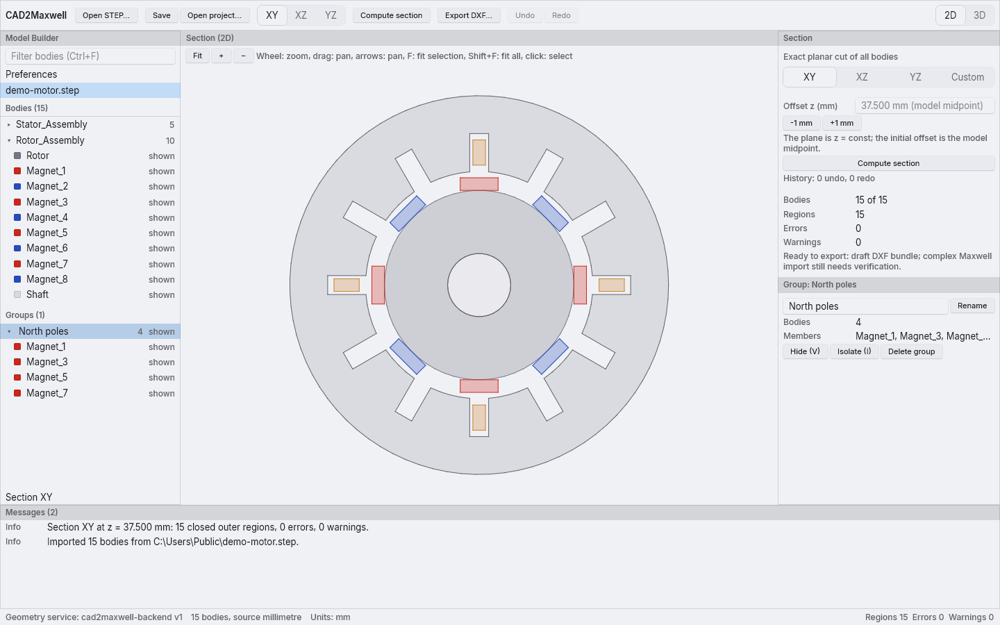
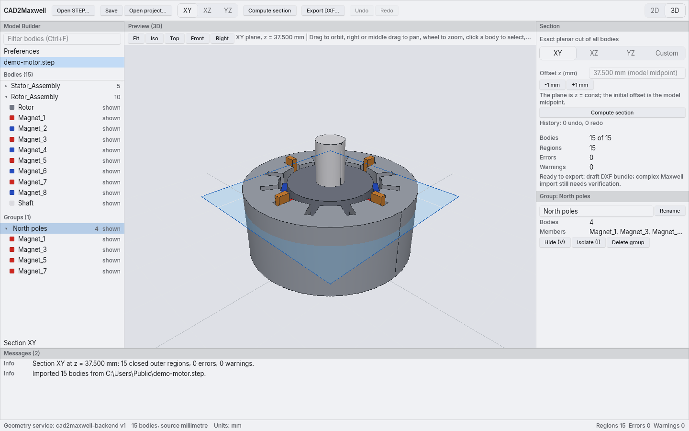
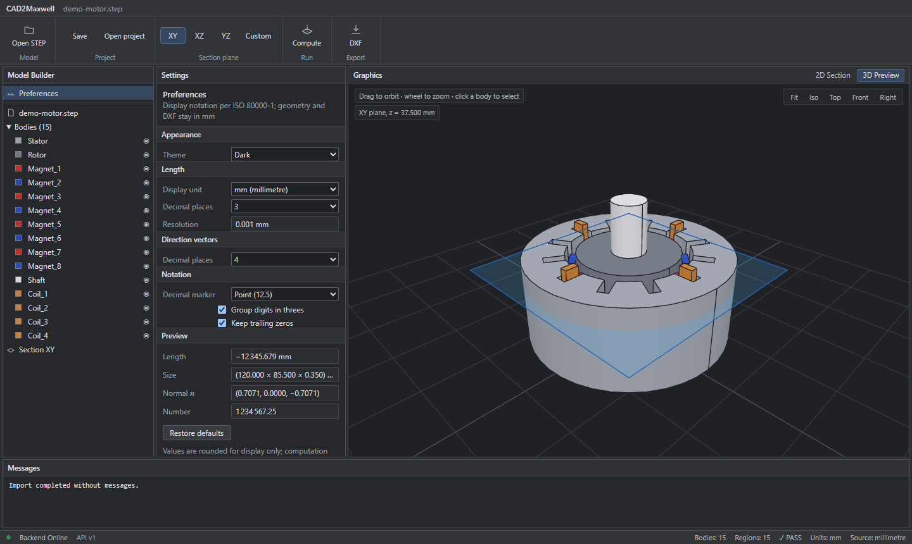

<div align="center">


# CAD2Maxwell

**Exact 2D sections from 3D STEP models, ready for ANSYS Maxwell 2D.**

Open a STEP assembly, pick a plane, check the section, export a 1:1 DXF in millimetres —
with every region traced back to its source body.

[](https://github.com/Jinksen/CAD-2D-convertor/actions/workflows/ci.yml)
[](https://github.com/Jinksen/CAD-2D-convertor/releases)
[](LICENSE)




</div>

## Why

Preparing a 2D electromagnetic model usually means a CAD drawing setup, manual cleanup and
guessing which polyline belonged to which part. CAD2Maxwell cuts the **exact B-Rep** with
OpenCascade, keeps names and colours, validates the result and refuses to export anything
broken — so what lands in Maxwell is what you modelled.

## Features

| | |
|---|---|
| **Exact geometry** | B-Rep sectioning with OpenCascade. No mesh slicing; lines, arcs and circles stay analytic. |
| **Traceability** | Source names, colours and assembly paths are kept. A JSON manifest maps every 2D region to its body; export names are ASCII-safe and deterministic. |
| **Validation** | Open contours, self-intersections, duplicate edges and overlaps block export. Tiny edges, small regions and slivers are flagged. Nothing is repaired silently. Click a diagnostic to jump to the body. |
| **Any plane** | XY / XZ / YZ with an offset, or a custom tilted plane aligned to a selected sheet in one click. Plane edits have undo/redo; the shown section is marked stale until you compute again. |
| **Engineering UI** | Model Builder tree, property pane, 2D viewport with zoom-at-cursor and pan, 3D preview with feature edges and standard views, visibility and isolate, light and dark themes, ISO 80000-1 number formatting. |
| **Projects** | Save the session as a `.c2mproj` (STEP path + hash, plane, preferences, visibility — never geometry) and reopen it later. |
| **Local only** | Runs fully offline. The geometry service listens on `127.0.0.1` with a per-session token; no telemetry. |

<table>
<tr>
<td></td>
<td></td>
</tr>
<tr>
<td align="center"><sub>3D preview with the section plane</sub></td>
<td align="center"><sub>Dark theme</sub></td>
</tr>
</table>

## Quick start

1. [Download](#download) and install CAD2Maxwell (or build it from source with the [one-time setup](#one-time-setup)).
2. Start **CAD2Maxwell** from the Start menu.
3. **Open STEP** (Ctrl+O) and choose a `.step` / `.stp` file. Try [`docs/demo/demo-motor.step`](docs/demo/demo-motor.step).
4. Pick a plane in the ribbon (keys **1 / 2 / 3** for XY / XZ / YZ) and set the offset in **Section** settings.
   For laminations that are not axis-aligned, select one sheet and click **Align to selected body**.
5. **Compute** (Ctrl+Enter). Filled regions are closed contours; holes stay empty.
6. **DXF** (Ctrl+E) saves a ZIP with `section.dxf` (1:1, mm) and `section.json`.
7. Import `section.dxf` into Maxwell 2D — see the [Maxwell import checklist](docs/maxwell-import-checklist.md).

The [walkthrough](docs/first-trial.md) covers the details and troubleshooting.

## Download

Get the latest build from [Releases](https://github.com/Jinksen/CAD-2D-convertor/releases) (Windows 10/11, x64):

| File | Use it when |
|------|-------------|
| `CAD2Maxwell_<version>_x64-setup.exe` | You want a normal install. Per-user, no administrator rights, uninstall from *Settings → Apps*. |
| `CAD2Maxwell_<version>_x64_portable.zip` | You cannot install software. Extract to a short path such as `C:\Tools\` and run `CAD2Maxwell\CAD2Maxwell.exe`. |

Python and Rust are **not** needed — the geometry service is bundled. Verify a download with
`Get-FileHash <file> -Algorithm SHA256` against `SHA256SUMS.txt`. The builds are not code-signed yet,
so Windows SmartScreen may ask once: *More info → Run anyway*.
The app writes its service log to `%LOCALAPPDATA%\com.cad2maxwell.desktop\logs\backend.log`.

## Keyboard shortcuts

| Key | Action | | Key | Action |
|-----|--------|-|-----|--------|
| Ctrl+O | Open STEP (projects: Open project… or drop a `.c2mproj`) | | F | Fit selection |
| Ctrl+S / Ctrl+Shift+S | Save project / save as | | Shift+F | Fit all |
| Ctrl+Enter | Compute section | | V | Show / hide selected body |
| Ctrl+E | Export DXF | | I | Isolate selected body |
| Ctrl+Z / Ctrl+Y | Undo / redo plane edits | | | |
| Ctrl+F | Filter bodies in Model Builder | | Esc | Clear selection |
| 1 / 2 / 3 | Plane XY / XZ / YZ | | Ctrl+1 / Ctrl+2 | 2D section / 3D preview |
| Wheel · drag | Zoom · pan (2D), zoom · orbit (3D) | | | |

## Export checks

Export is blocked with an error diagnostic when the section has open contours, invalid or
self-intersecting planar faces, duplicate edges, or positive-area overlaps between components.
Tiny edges, very small regions and slivers are reported as warnings and left untouched. Nothing is
silently repaired or merged, and existing files are never overwritten.

## One-time setup

Only needed to build from source. Windows 11 with Git, Python 3.12+ and [uv](https://docs.astral.sh/uv/), Rust stable and Visual Studio 2022 Build Tools
(**Desktop development with C++**). Running the app needs a GPU-capable Windows desktop; tests are headless.
Building the installer also needs [Inno Setup 6](https://jrsoftware.org/isinfo.php) (`winget install JRSoftware.InnoSetup`).

```powershell
.\scripts\setup.ps1             # fetch the pinned Rust and Python dependencies
.\scripts\build-trial.ps1       # build artifacts/CAD2Maxwell/CAD2Maxwell.exe
.\scripts\install-shortcuts.ps1 # add CAD2Maxwell to the Desktop and Start menu
```

The shortcuts point at this checkout, so keep the folder where it is (re-run `install-shortcuts.ps1`
after moving it; `-Remove` removes them). After `git pull`, run `setup.ps1` and `build-trial.ps1` again.

## Command line

The same conversion without the UI:

```powershell
uv run --project backend python -m cad2maxwell_backend.cli `
  --input "C:\Projects\Motor\assembly.step" `
  --plane XY --offset-mm 110.0 `
  --output "C:\Projects\Motor\section.dxf"
```

The output path must be absolute and unused; the command writes `section.dxf` and `section.json`.

## Architecture

```text
Rune native UI ──► Rust service adapter ──► local FastAPI service ──► OpenCascade exact geometry
 (no CAD objects)   (dialogs, process)      (sessions, validation)     (STEP/XCAF, B-Rep section)
```

The UI only ever sees typed DTOs; exact shapes stay in the Python process. Sessions are bounded,
section results are cached per plane, and bodies whose bounding box misses the plane are skipped.
More in [architecture](docs/architecture.md), [geometry](docs/geometry.md),
[DXF export](docs/dxf-export.md) and [UX](docs/ux.md).
[`CAD2Maxwell_PROJECT_SPEC.md`](CAD2Maxwell_PROJECT_SPEC.md) is the product source of truth.

The Rune migration plan, gate results and known gaps are in
[docs/rune-migration.md](docs/rune-migration.md).

## Known limitations

- Exports are marked `draft_unvalidated` until the [Maxwell import checklist](docs/maxwell-import-checklist.md) has been run on real models.
- **Align to selected body** needs a body with planar faces, such as a sheet.
- The 3D preview is coarsened above 50,000 triangles; sectioning always uses the exact geometry.
- Port 8000 must be free, so one instance runs at a time.
- Windows x64 only; builds are not code-signed yet.

## Development

The desktop UI is a native Rust app built with the [Rune](https://github.com/anomalyco/rune) framework (`frontend/rune-app`, pinned revision). See the [Rune migration plan](docs/rune-migration.md) before changing desktop architecture.

```powershell
.\scripts\dev.ps1    # desktop app (cargo run) with a local backend
.\scripts\build-release.ps1   # installer, portable ZIP and SHA256SUMS in artifacts/release
.\scripts\test.ps1   # quality gate: Ruff, mypy, pytest, cargo fmt/clippy/test for the Rune app, Pester
uv run --project backend python scripts/demo/make_demo_motor.py   # regenerate the demo model
```

CI runs `scripts/test.ps1` on pull requests and pushes to `main` when GitHub Actions is enabled for the repository; otherwise run it locally before merging. See [CONTRIBUTING.md](CONTRIBUTING.md),
[SECURITY.md](SECURITY.md) and [AGENTS.md](AGENTS.md) (also covers using the PyCharm MCP tools).

## License

[MIT](LICENSE). The demo motor is synthetic and generated by the script above.
