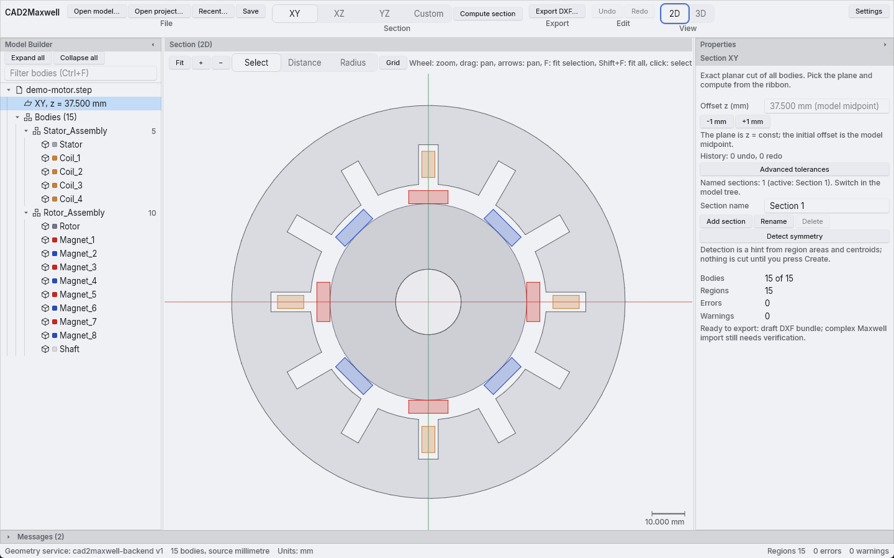
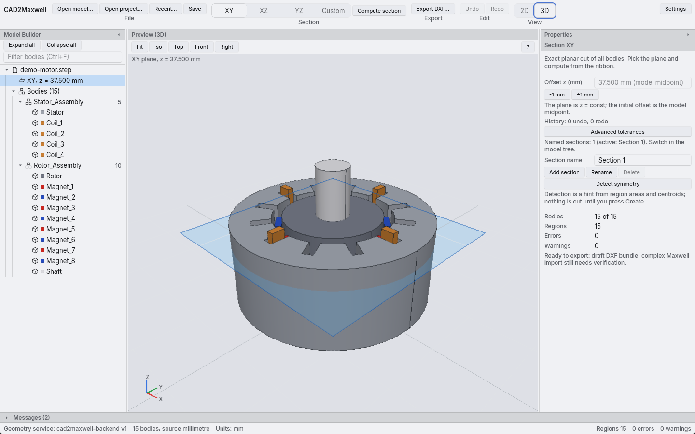
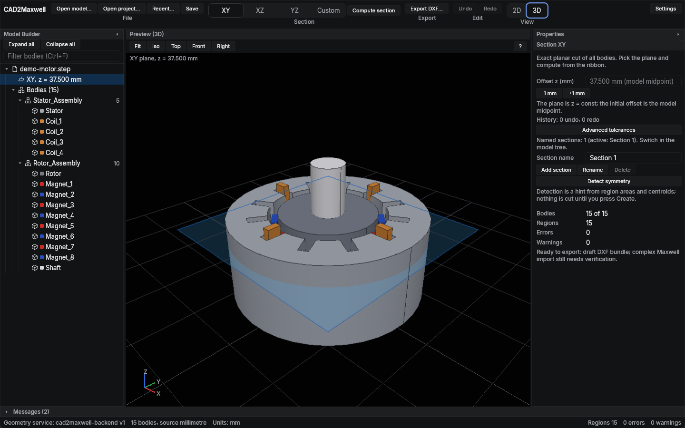

<div align="center">

<picture>
  <source media="(prefers-color-scheme: dark)" srcset="docs/images/logo-dark.svg">
  
</picture>

# CAD2Maxwell

**CAD models to exact 2D sections for ANSYS Maxwell 2D and other 2D FEM tools.**

[](https://github.com/Jinksen/CAD-2D-convertor/actions/workflows/ci.yml)
[](https://github.com/Jinksen/CAD-2D-convertor/releases)
[](https://jinksen.github.io/CAD-2D-convertor/)
[](LICENSE)




</div>

## Why

Preparing a 2D electromagnetic model usually means manual drawing cleanup and guessing which
polyline belonged to which part. CAD2Maxwell cuts the exact B-Rep with OpenCascade, keeps names
and colours, validates the result and refuses to export a broken section. Every 2D region traces
back to its source body.

## Workflow

1. **Open model.** STEP, IGES or BREP (Ctrl+O), or drop the file on the window.
2. **Pick a plane.** XY / XZ / YZ with an offset, or a custom plane aligned to a selected sheet.
3. **Compute** (Ctrl+Enter). Regions are closed contours; holes stay empty.
4. **Check.** Read the diagnostics, measure, compare with the 3D preview.
5. **Export** (Ctrl+E). DXF plus manifest, optionally CSV, SVG, FEMM, Gmsh or PyAEDT.

## Features

| Area | What you get | Details |
|------|--------------|---------|
| Import | STEP, IGES (solid B-Reps) and OCCT BREP with names, colours and assembly structure. | [Projects and formats](docs/projects-and-formats.md) |
| Section | Axis or tilted planes, advanced tolerances, several named sections, symmetry hint with explicit 1/N sector. | [Geometry](docs/geometry.md) |
| Validation | Open contours, invalid faces, duplicates and overlaps block export; small features warn. | [Export checks](#export-checks) |
| Export | DXF 1:1 mm + manifest v2 (layer and colour modes, material labels); CSV, SVG, FEMM, Gmsh, PyAEDT. | [DXF export](docs/dxf-export.md) |
| Workspace | Model tree, 2D and 3D viewports, measuring, exact region metrics, light/dark theme, settings dialog. | [UX](docs/ux.md), [Settings](docs/settings.md) |
| Projects | `.c2mproj` files, unsaved-changes prompt, autosave with recovery, recent projects. | [Projects and formats](docs/projects-and-formats.md) |
| Local only | Offline. Service listens on `127.0.0.1` with a per-session token. No telemetry. | [Architecture](docs/architecture.md) |

<table>
<tr>
<td></td>
<td></td>
</tr>
<tr>
<td align="center"><sub>3D preview with the section plane</sub></td>
<td align="center"><sub>Dark theme</sub></td>
</tr>
</table>

## Supported formats

| Format | Direction | Notes |
|--------|-----------|-------|
| STEP `.step` `.stp` | Import | Names, colours, assemblies (XCAF). |
| IGES `.igs` `.iges` | Import | Solid B-Reps only; surface-only files are rejected, not sewn. |
| OCCT BREP `.brep` | Import | No names or colours; unit assumed mm and reported. |
| DXF + JSON manifest | Export | R2013, 1:1 mm, analytic LINE/ARC/CIRCLE/ELLIPSE. Always written. |
| CSV | Export | Region table: area, perimeter, centroid, holes. |
| SVG | Export | 1 unit = 1 mm, exact arcs. |
| FEMM `.lua` | Export | Exact arcs, block labels per region. |
| Gmsh `.geo` | Export | Arcs split below 180 degrees, physical surfaces per body and group. |
| PyAEDT `.py` | Export | Text script; PyAEDT is not required to run the app. |
| STL, OBJ, 3MF | Rejected | Triangle meshes cannot carry exact geometry; slicing them is not exact sectioning. |
| Parasolid, ACIS, JT | Not supported | No free OpenCascade reader. Export STEP instead. |

## Quick start

1. [Download](#download) and install, or build from source with the [one-time setup](#one-time-setup).
2. Start **CAD2Maxwell**. **Open model** (Ctrl+O) or **Open demo motor** ([`docs/demo/demo-motor.step`](docs/demo/demo-motor.step)).
3. Pick a plane (keys **1 / 2 / 3**) and set the offset in **Section**. For a tilted lamination, select one sheet and click **Align to selected body**.
4. **Compute** (Ctrl+Enter), then **DXF** (Ctrl+E). The ZIP holds `section.dxf` (1:1, mm) and `section.json`.
5. Import the DXF into Maxwell 2D with the [Maxwell import checklist](docs/maxwell-import-checklist.md).

The [walkthrough](docs/first-trial.md) has details and troubleshooting.

## Download

Get the latest build from [Releases](https://github.com/Jinksen/CAD-2D-convertor/releases) (Windows 10/11, x64):

| File | Use it when |
|------|-------------|
| `CAD2Maxwell_<version>_x64-setup.exe` | You want a normal install. Per-user, no administrator rights, uninstall from *Settings → Apps*. |
| `CAD2Maxwell_<version>_x64_portable.zip` | You cannot install software. Extract to a short path such as `C:\Tools\` and run `CAD2Maxwell\CAD2Maxwell.exe`. |

Python and Rust are not needed; the geometry service is bundled. Verify a download with
`Get-FileHash <file> -Algorithm SHA256` against `SHA256SUMS.txt`. The builds are not code-signed yet,
so Windows SmartScreen may ask once: *More info → Run anyway*.
The app writes its service log to `%LOCALAPPDATA%\com.cad2maxwell.desktop\logs\backend.log`.

## Keyboard shortcuts

| Key | Action |
|-----|--------|
| Ctrl+O | Open model (to open a project, use *Open project…* or drop a `.c2mproj` on the window) |
| Ctrl+, | Settings |
| Ctrl+Q | Quit (asks about unsaved changes) |
| Ctrl+S / Ctrl+Shift+S | Save project / save as |
| Ctrl+Enter | Compute section |
| Ctrl+E | Export DXF |
| Ctrl+Z / Ctrl+Y | Undo / redo plane edits |
| Ctrl+F | Filter bodies in Model Builder |
| Ctrl+1 / Ctrl+2 | 2D section / 3D preview |
| 1 / 2 / 3 | Plane XY / XZ / YZ |
| F / Shift+F | Fit selection / fit all |
| V | Show or hide the selected body or group |
| I | Isolate the selected body or group |
| Esc | Clear selection |
| Wheel, drag | 2D: zoom at cursor, pan. 3D: zoom, orbit with the left button, pan with the others (see the mouse presets in Settings) |
| Arrows, + / − | Pan and zoom the 2D view |

## Export checks

Export is blocked with an error diagnostic when the section has open contours, invalid or
self-intersecting planar faces, duplicate edges, or positive-area overlaps between components.
Tiny edges, very small regions and slivers are reported as warnings and left untouched. Nothing is
silently repaired or merged, and existing files are never overwritten.

## One-time setup

Only needed to build from source. Windows 11 with Git, Python 3.12+ and [uv](https://docs.astral.sh/uv/), Rust stable and Visual Studio 2022 Build Tools
(**Desktop development with C++**). Running the app needs a GPU-capable Windows desktop; tests are headless.
Building the installer also needs [Inno Setup 6](https://jrsoftware.org/isinfo.php) (`winget install JRSoftware.InnoSetup`).

```powershell
.\scripts\setup.ps1             # fetch the pinned Rust and Python dependencies
.\scripts\build-trial.ps1       # build artifacts/CAD2Maxwell/CAD2Maxwell.exe
.\scripts\install-shortcuts.ps1 # add CAD2Maxwell to the Desktop and Start menu
```

The shortcuts point at this checkout, so keep the folder where it is (re-run `install-shortcuts.ps1`
after moving it; `-Remove` removes them). After `git pull`, run `setup.ps1` and `build-trial.ps1` again.

## Command line

The same conversion without the UI:

```powershell
uv run --project backend python -m cad2maxwell_backend.cli `
  --input "C:\Projects\Motor\assembly.step" `
  --plane XY --offset-mm 110.0 `
  --output "C:\Projects\Motor\section.dxf"
```

The output path must be absolute and unused; the command writes `section.dxf` and `section.json`.

### Batch job

`--job job.json` writes one export per section into an existing absolute output folder. Names are ASCII (`A-Z a-z 0-9 _ -`), the job is validated before anything runs, and nothing is written if any target already exists. `formats` accepts `dxf` (default), `csv`, `svg`, `femm`, `gmsh` and `pyaedt`; each is written as `<name>.<ext>` (`.csv`, `.svg`, `.lua`, `.geo`, `.py`) next to `<name>.dxf` and `<name>.json`. If any of these files exists, nothing is written.

```json
{"input": "C:\\Projects\\Motor\\assembly.step", "output_dir": "C:\\Projects\\Motor\\sweep",
 "sections": [{"name": "mid", "plane": "XY", "offset_mm": 25.0},
              {"name": "end", "plane": "XY", "offset_mm": 48.0, "formats": ["dxf"]}]}
```

The input may be STEP, IGES or BREP. Backslashes in JSON strings are written as `\\` (or use `/`).

## Documentation

Site: <https://jinksen.github.io/CAD-2D-convertor/>. Sources and index: [docs/README.md](docs/README.md).
Product source of truth: [`CAD2Maxwell_PROJECT_SPEC.md`](CAD2Maxwell_PROJECT_SPEC.md). Release history: [CHANGELOG.md](CHANGELOG.md).

## Architecture

```text
Rune native UI ──► Rust service adapter ──► local FastAPI service ──► OpenCascade exact geometry
 (no CAD objects)   (dialogs, process)      (sessions, validation)     (STEP/XCAF, B-Rep section)
```

The UI only sees typed DTOs; exact shapes stay in the Python process. See [architecture](docs/architecture.md) and [geometry](docs/geometry.md).

## Known limitations

- Exports are marked `draft_unvalidated`: the [Maxwell import checklist](docs/maxwell-import-checklist.md) has only been run on simple samples.
- FEMM, Gmsh and PyAEDT outputs are checked structurally in tests; they have not been opened in those tools. Ellipses are rejected by the FEMM and Gmsh writers.
- Motor-CAD DXF import is unverified; there is no preset.
- Region-based formats (CSV, SVG, FEMM, Gmsh, PyAEDT) need a section computed in the same session.
- The window close button cannot ask about unsaved changes (pinned Rune revision); a recovery file is kept instead.
- Material labels are your own notes, not Maxwell library materials. The symmetry hint compares areas and centroids, not outlines.
- **Align to selected body** needs a body with planar faces. The 3D preview is coarsened above 50,000 triangles; sectioning uses exact geometry.
- IGES levels are not mapped. Picking one region among several of the same body is not available.
- Windows x64 only, GPU-capable desktop required. Builds are not code-signed.

## Development

The desktop UI is a native Rust app on the pre-release [Rune](https://github.com/anomalyco/rune) framework (`frontend/rune-app`, pinned revision). Read [docs/rune-migration.md](docs/rune-migration.md) before changing the desktop architecture.

```powershell
.\scripts\dev.ps1             # desktop app (cargo run) with a local backend
.\scripts\test.ps1            # quality gate: Ruff, mypy, pytest, cargo fmt/clippy/test, Pester
.\scripts\build-release.ps1   # installer, portable ZIP and SHA256SUMS in artifacts/release
uv run --project backend python scripts/demo/make_demo_motor.py   # regenerate the demo model
```

Development scripts use port 8000; installed builds pick a free port. CI runs `scripts/test.ps1` when GitHub Actions is enabled; otherwise run it locally. See [CONTRIBUTING.md](CONTRIBUTING.md), [SECURITY.md](SECURITY.md), [AGENTS.md](AGENTS.md) and the [release checklist](docs/release.md).

## License

[MIT](LICENSE). The demo motor is synthetic and generated by the script above.
